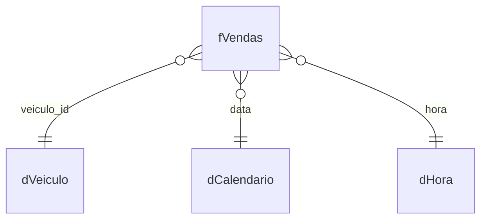

# Modelo de dados — Car Sales

## Inventário

O resumo apresenta **4 tabelas de dados** e **17 medidas**. O inventário também inclui `Medidas`, uma tabela organizadora sem colunas listadas.

| Tabela | Tipo | Colunas | Linhas |
| --- | --- | --- | --- |
| Medidas | Medidas | 0 | — |
| dCalendario | Calendário | 8 | 1.096 |
| dHora | Dimensão | 8 | 86.400 |
| fVendas | Fato | 4 | 7.909 |
| dVeiculo | Dimensão | 5 | 8 |

## Relacionamentos

| # | Origem | Destino | Cardinalidade | Direção | Ativo |
| --- | --- | --- | --- | --- | --- |
| 1 | fVendas[veiculo_id] | dVeiculo[veiculo_id] | N:1 | Única | ✓ |
| 2 | fVendas[data] | dCalendario[data] | N:1 | Única | ✓ |
| 3 | fVendas[hora] | dHora[Hora] | N:1 | Única | ✓ |

## Esquema conceitual

A tabela fato `fVendas` contém **7.909 linhas**. As dimensões `dCalendario`, `dHora` e `dVeiculo` contêm, respectivamente, **1.096**, **86.400** e **8** linhas. O total registrado é de **95.413 linhas**.

As relações listadas são ativas, com cardinalidade N:1 e direção de filtro única. O arquivo-fonte não fornece o esquema completo de todas as 25 colunas; não foram inventados nomes de colunas ausentes.

**Fontes citadas no inventário:** CSV, Excel, JSON e tabela inserida manualmente. Não são incluídos caminhos locais, credenciais ou dados transacionais.
